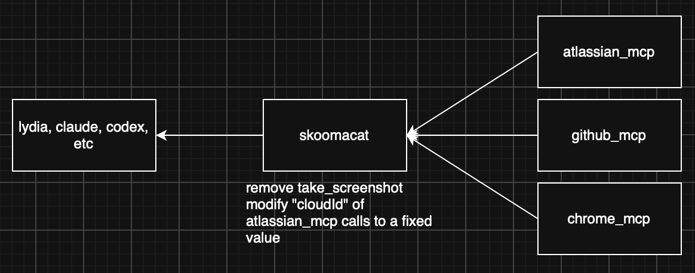

# skoomacat

## Why?

Let's say you want to use AI to browse a website, but you don't want to take screenshots because this makes your cost skyrocket. In traditional MCP use cases, you are reduced to a powerless slave, begging Masters Amodei and Altman to allow you the privilege of not tokenmaxxing by not calling take_screenshot

This is clearly an absurd and unacceptable scenario - if you are using your computer, you should decide what MCP calls your computer makes without relying on an LLM output.

skoomacat solves this problem, by letting you use your browser MCP and just remove take_screenshot out of the tool catalog (or adjust it's tool description to alter it's use case, or use a Python prehook to firewall the call yourself)

## Overview

skoomacat is a basic mcp proxy, allowing a client to access multiple MCP's via  a single, unified json-over-http interface. it allows fine-grained control over exposed tools (directly overwriting the exposed tool directory), as well as pre- and post- processing of tool calls.

there are two primary modes of use:

* skoomacat --mcp [mcp_uri] --mcp [mcp_uri] out.json will load both mcp_uri's (using lydia's MCPLoader mechanism, then save the tool catalog into a template out.json
* skoomacat [in.json] will load the profile from in.json and serve it on localhost:8000

An MCP client can then connect to the new mcp, http://localhost:8000/, which exposes the tool catalog defined in the json config file.

## Function Hooks

skoomacat supports pre and post hooking for MCP functions. Have a look in moonsugar/examples/hooks.json for how to define hooks. You can use this to "wrap" a function call in arbitrary python code, modifying the arguments passed to the function, skipping the function entirely or modifying the returned value.

Prehooks and posthooks are run via 'exec'. To override the output of an MCP call in a posthook, use output(new_result).

A prehook and posthook for a function named "*" will be treated as a global hook, and will execute on every function call".

This can be used for:

- Fixing parameters hallucinations (e.g. "always use this tenant id")
- Adding delays to tool calls (r2 analyze I'm looking at you)
- Firewalling MCP's, toolcall visiblity
